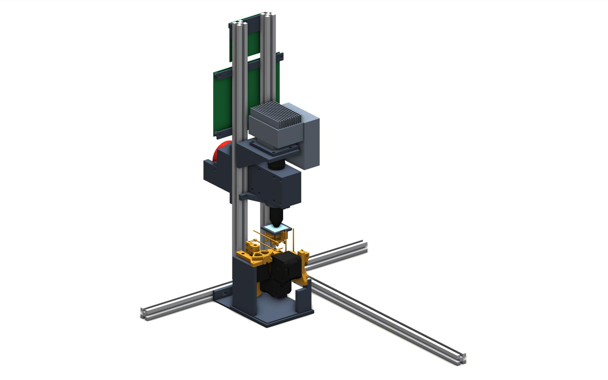
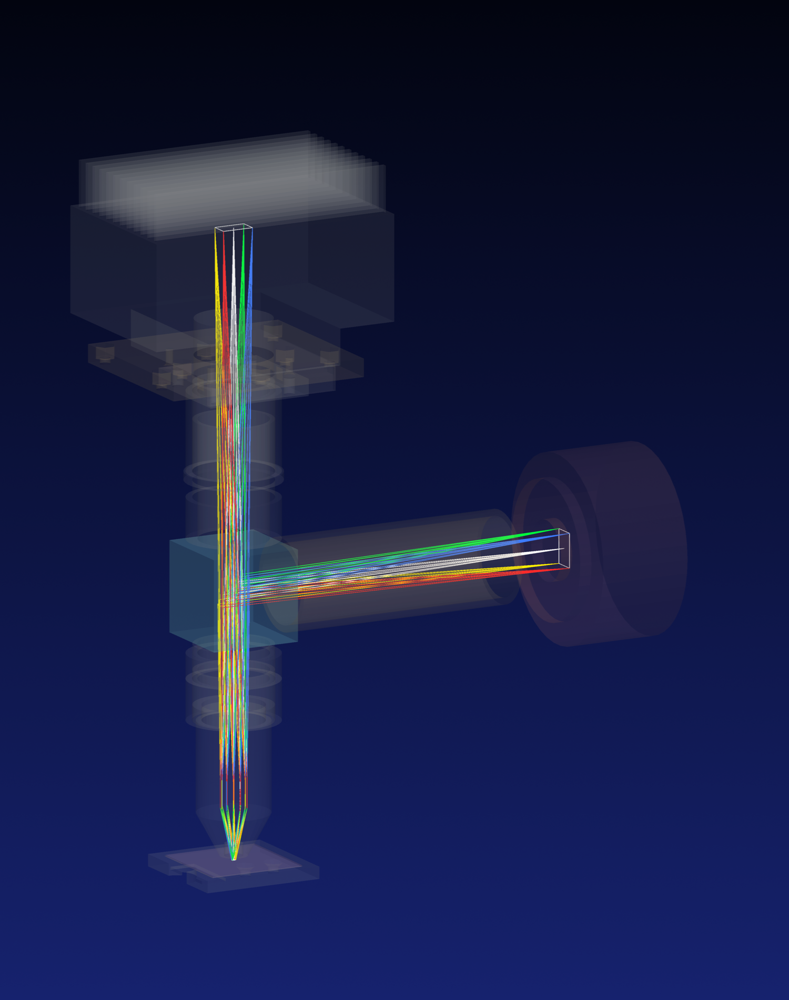
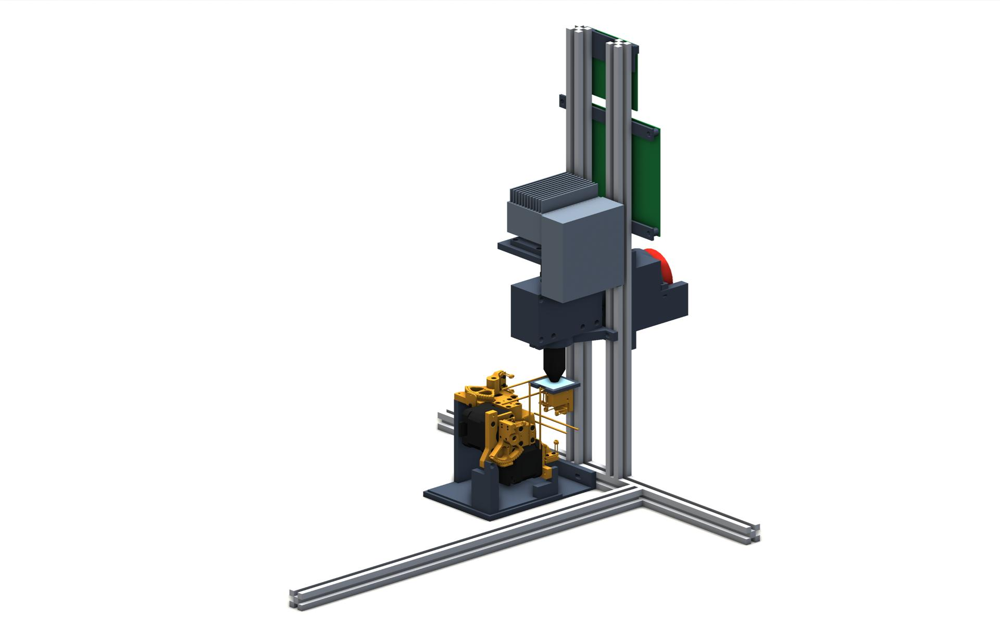

# Lithography stepper

A maskless lithography stepper: projector, optics, camera, chip stage, and the frame that holds them together.



The goal is to expose patterns with **<1 µm features** on a photoresist-coated chip. A DLP projector supplies the pattern, a microscope objective reduces it, and a micro-manipulator positions the chip below the objective. The mounts and brackets are generated in Python, so changing a dimension means editing a parameter and rebuilding the parts.

This repo contains the full mechanical assembly, the printable parts, and optical simulations. The micro-manipulator comes from a separate project; its source files and attribution are linked in [RESOURCES.md](RESOURCES.md).

## Where it stands

The current work is CAD and simulation. The printed parts have not been printed or fit-tested yet, and there are no measured exposure results in this repo.

The distinction between pixel size and printable feature size matters here. With 10× reduction, one projector pixel covers **0.54 µm** at the chip. The present 400 nm, NA 0.25 optical model puts reliable line widths closer to **1.1 µm**. Submicron features are the target; they still need to be demonstrated in resist. [The optics notes](docs/optics.md) show the assumptions and simulations behind those numbers.

## How it works

Light travels down from the projector's digital micromirror device (DMD), through a beamsplitter cube and a 10× objective, to the chip. The chip sits on the micro-manipulator below the objective. Moving the stage lets the machine expose another part of the chip.

The camera looks back through the same objective. Light from the chip travels up to the cube, then turns toward the camera at the rear of the frame. Matching the camera and projector optical distances gives a common starting point for focus. UV exposure focus still needs its own calibration.



| Item | Current design |
| --- | --- |
| Projector | DLP471TP, 1920 × 1080 mirrors, 5.4 µm pitch |
| Exposure wavelength | 400 nm |
| Objective | Edmund Optics #43-907, 10×, NA 0.25 |
| Projected pixel pitch | 0.54 µm |
| Projected field | About 1.04 × 0.58 mm |
| Camera | ZWO ASI174MM; about 1.14 × 0.71 mm at the chip |
| Depth of focus | About ±3.2 µm in the ideal-lens model |
| Frame footprint | 500 × 520 mm |
| Frame height | 520 mm |

Focus is one of the tighter constraints: a few micrometres of chip-height error reduces the contrast of narrow lines. Dose matters too. The simulations cover diffraction, defocus, line contrast, and a simple resist threshold; they do not model the actual resist chemistry or the objective's unpublished lens prescription.

See [optics.md](docs/optics.md) for the calculations and [procedures.md](docs/procedures.md) for the focus and exposure checks.

## Look around the assembly

| Front quarter | Opposite quarter |
| --- | --- |
|  |  |

The complete model is checked in as [STEP](assembly/public/stepper.step) and [GLB](assembly/public/stepper.glb). Open the STEP file in a CAD tool to inspect dimensions, or use the browser viewer:

```sh
python3 -m http.server 8765
```

Open [localhost:8765/viewer/](http://localhost:8765/viewer/). Drag to rotate the model. **Optics only** hides the frame and stage; **Chip close-up** moves the camera to the exposure plane. The ray controls switch between individual mirrors and the full projected field.

The shared models use a simplified projector body. Manufacturer CAD belongs in the ignored `vendor/` directory; assemblies built from it go in `assembly/private/`. Keep those files local. [assembly.md](docs/assembly.md) lists the sources and dimensions of the purchased parts.

## Build the parts

Install [uv](https://docs.astral.sh/uv/), clone the repo, and run:

```sh
git clone https://github.com/uofthackerfab/lithography-stepper-3d-cad.git
cd lithography-stepper-3d-cad
uv run python -m cad.build
```

The project uses Python 3.11 or 3.12. The build writes STL files to `stl/`, STEP files to `step/`, and checks that each printed part is a single closed mesh with consistent winding and no dimension over 200 mm. A passing part prints `OK`.

To rebuild one part:

```sh
uv run python -m cad.build 04_tube_clamp
```

Edit shared dimensions in [`cad/params.py`](cad/params.py). Individual part geometry lives in [`cad/parts/`](cad/parts/). To regenerate the full assembly and check for collisions:

```sh
uv run --with pyvista python -m cad.assembly
```

For printing, start with [parts.md](docs/parts.md): it lists quantities, materials, screws, and orientation. The current recommendation is a 0.4 mm nozzle, 0.2 mm layers, four walls, 40% infill, and no supports. Those settings still need a physical test. Light-path parts need opaque black material; the projector mounts use PETG or ASA because they sit near a heat source.

## Run the optics checks

```sh
# First-order optical numbers and a side-view ray diagram
uv run --with optiland python -m optics.layout

# 3D ray views and the browser viewer's ray data
uv run --with optiland --with pyvista python -m optics.rays

# Diffraction, line contrast, defocus, resist threshold, and dose
uv run --with optiland python -m optics.simulate
```

To render the gallery views from the checked-in public GLB:

```sh
uv run --no-project --python 3.12 --with pyvista --with trimesh python cad/render_gallery.py
```

## Files

| Path | What's there |
| --- | --- |
| [`stl/`](stl/) | Printable parts in their print orientations |
| [`cad/params.py`](cad/params.py) | Shared dimensions and fit allowances |
| [`cad/parts/`](cad/parts/) | Python geometry for each printed part |
| [`cad/assembly.py`](cad/assembly.py), [`cad/purchased.py`](cad/purchased.py) | Part placement and purchased component models |
| [`assembly/public/`](assembly/public/) | Shareable STEP and GLB assemblies |
| [`viewer/`](viewer/) | Interactive assembly and light-path viewer |
| [`optics/`](optics/) | Ray tracing and image simulations |
| [`docs/assembly.md`](docs/assembly.md) | Assembly views, coordinates, and dimensions |
| [`docs/parts.md`](docs/parts.md) | Parts, hardware, and print settings |
| [`docs/procedures.md`](docs/procedures.md) | Printing, assembly, focus, and test exposures |
| [`docs/dimensions.md`](docs/dimensions.md) | Dimension sources and open questions |
| [`RESOURCES.md`](RESOURCES.md) | Component links and upstream projects |

## Next steps

Print the mounts, check the fits, and assemble the optical path. Then find the UV focus and exposure dose with test patterns. Measured line widths, repeatability of the stage, and registration between adjacent exposures will tell us what the complete machine can actually do.
