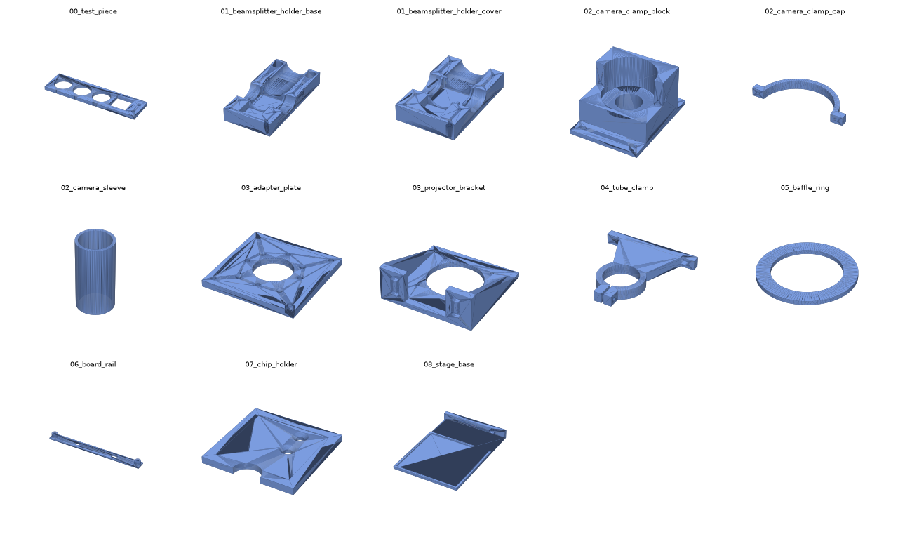

# Lithography stepper: printed parts

This repository contains the 3D-printed parts of the maskless lithography stepper.
It does not contain the micro-manipulator parts. See [RESOURCES.md](RESOURCES.md) for those files.

The parts are drawn by code. The STL files in `stl/` are ready for a slicer.
A slicer is the program that converts an STL file into printer instructions.



## Status

- All 13 STL files are closed meshes and each one is smaller than 200 mm.
- A geometry check found no overhang that needs supports.
- No part is printed yet. A fit is confirmed only after a print.
- The fits tolerate a printer error of ±0.2 mm. The test piece is optional.

## Contents

| Path | Contents |
|---|---|
| `stl/` | STL files, in print orientation |
| `cad/params.py` | All dimensions |
| `cad/parts/` | One file for each part |
| `cad/build.py` | Builds and checks all parts |
| [docs/parts.md](docs/parts.md) | Part list, print settings, screws |
| [docs/procedures.md](docs/procedures.md) | Test piece, print, and assembly procedures |
| [docs/dimensions.md](docs/dimensions.md) | Dimensions with their sources, and open items |
| [RESOURCES.md](RESOURCES.md) | All links |

## Build the STL files

1. Install [uv](https://docs.astral.sh/uv/).
2. Go to the repository folder.
3. Run this command:

```bash
uv run python -m cad.build
```

The command writes `stl/` and `step/`. It prints `OK` for each part that passes the mesh check.

To build one part, add its name:

```bash
uv run python -m cad.build 04_tube_clamp
```

## Change a dimension

1. Open `cad/params.py`.
2. Change the value.
3. Run the build command again.
