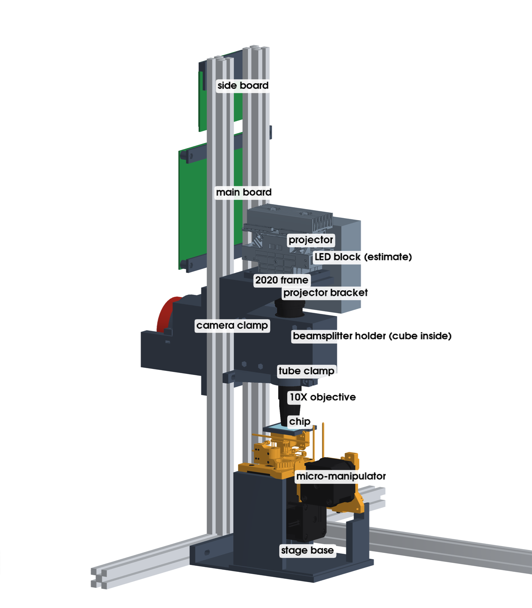

# Assembly

The file `assembly/public/stepper.step` contains all parts in their positions. Each part has a name and a colour.



| View | File |
|---|---|
| Front | [img/assembly_front.png](img/assembly_front.png) |
| Back | [img/assembly_back.png](img/assembly_back.png) |
| Left | [img/assembly_left.png](img/assembly_left.png) |
| Right | [img/assembly_right.png](img/assembly_right.png) |
| Top | [img/assembly_top.png](img/assembly_top.png) |
| From above, at 45° | [img/assembly_angle.png](img/assembly_angle.png) |

## Open the model

There are two folders:

| Folder | Projector | Use |
|---|---|---|
| `assembly/public/` | Simple shape with the correct outside dimensions | Share it, for example on Onshape |
| `assembly/private/` | The manufacturer's model | Most accurate. Do not share it. Git ignores this folder. |

The build writes `assembly/private/` only if the file `vendor/projector.brep` is present.

Each folder contains two files:

- `stepper.step`: open it in FreeCAD, Fusion or Onshape. You can measure each distance there.
- `stepper.glb`: open it in MeshLab or a web 3D viewer. Use it only to look.

## Look at the model in a browser

1. Go to the repository folder.
2. Run this command:

```bash
python3 -m http.server 8765
```

3. Open `http://localhost:8765/viewer/` in a browser.
4. Drag to turn the model. Use the buttons to change between the private and the public model.
5. Click **Optics only** to see only the parts on the light paths, with the light rays. The two switches below the buttons show or hide each light path. Click **Full machine** to see all parts. See [optics.md](optics.md).

## Build the model

```bash
uv run --with pyvista python -m cad.assembly
```

The command prints the position of each part. It also tests each pair of parts for a collision. The result now is `no collisions`.

## Axes

- x points to the right. y points to the rear. z points up.
- The optical axis is x = 0, y = 0. The table is z = 0.

## Main dimensions (mm)

| Item | Value | Status |
|---|---|---|
| Chip surface above the table | 134.7 | [V] from part dimensions |
| Objective tip above the chip | 1.5 | [V] |
| Objective shoulder | z = 180.2 | [V] |
| Centre of the beamsplitter cube | z = 222.2 | [V] |
| Front face of the camera | y = 111.7 | [E] uses the 150 image distance |
| Projector lens face | z = 299.0 | [V] 41.4 from mirror chip to lens face, projector CAD |
| Top of the projector | z = 361 | [V] projector CAD |
| Top of the uprights | z = 520 | [V] |
| SM1V10 travel in use | 8.4 of 20.6 | [E] |
| Footprint of the frame | 500 × 520 | [V] |

## Lens tubes in the model

| Arm | Parts, from the cube outward |
|---|---|
| Down | SM1L03, SM1L05, SM1A3 (inside the SM1L05), objective |
| Up | SM1V10 (collar in the holder), SM1L10, SM1A53, adapter plate, projector |
| Rear | printed sleeve, camera |

## Source of each model

"Private" is the model in `assembly/private/`. "Public" is the model in `assembly/public/`.

| Part | Private | Public |
|---|---|---|
| Printed parts | This repository | Same |
| Micro-manipulator and stand | CAD of the project (MIT licence) | Same |
| Motors of the micro-manipulator | STEPPERONLINE STEP file for 17HM15-0904S | Drawing of a 42 × 42 × 40 motor from the project's CAD |
| Projector light engine | Manufacturer's model, from the Hacker Fab assembly | Simple shape |
| Projector LED block | Simple shape [E]. No model is available. | Same |
| SM1L03, SM1L05, SM1L10, SM1V10, SM1A53, SM1A3 | Thorlabs STEP files | Simple shapes |
| Objective | Edmund Optics STEP file for #43-907 | Simple shape |
| Camera | Simple shape. ZWO publishes no model of this body. Dimensions from the ZWO drawing. | Same |
| Main board | Plate with the outline and holes of the TI layout files. TI publishes no 3D model. | Same |
| Beamsplitter cube, 2020 bars | Simple shapes with the correct dimensions | Same |

- The manufacturers' files are in `vendor/`. Git ignores this folder. Do not share these files.
- `cad/purchased.py` puts each manufacturer's model in the position of the simple shape. The sizes agree within 0.05 mm.
- The motor cables point away from the stand. This is the only direction in which the cable outlet is free.
- The build does two collision checks: one with the simple shapes, one with the manufacturers' models. In the second check, the overlap of mated screw threads is ignored.
- Screws of the frame, nuts, T-nuts, corner brackets, felt, cables and wires are not shown.

## Purchased parts that are not in the model

| Part | Reason |
|---|---|
| SM1V05, SM1CPL05 | Spare. The model does not need them. |
| SM1A9 | Not used. It has a C-mount thread and the camera has an M42 thread. |
| Arduino, CNC shield, A4988 and TMC2209 drivers, proximity sensor | Electronics with no fixed position |
| Pico 2, MT6835 encoders, buck converter, connectors, wires | Electronics of the micro-manipulator |
| Balls, brass rod, cord, magnets, crimp beads | Small parts inside the micro-manipulator |
| UV LEDs, Pico-SPOX connectors | Inside the projector |
| Power supplies | On the table |
