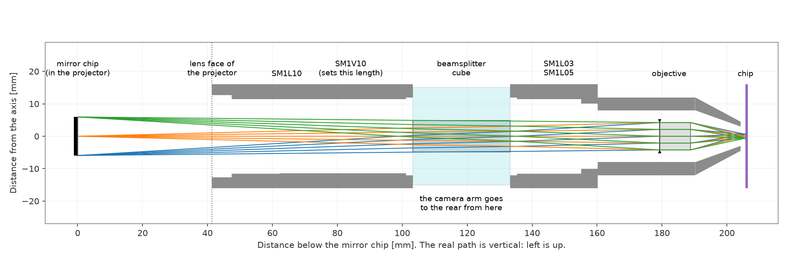
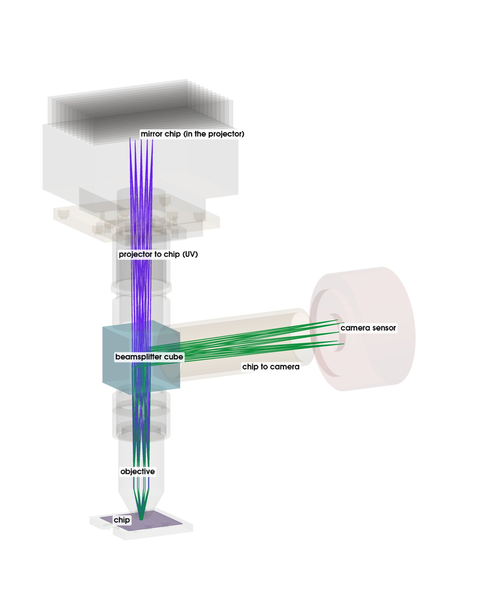
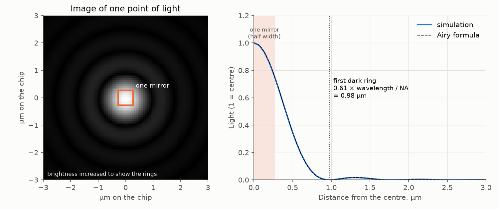
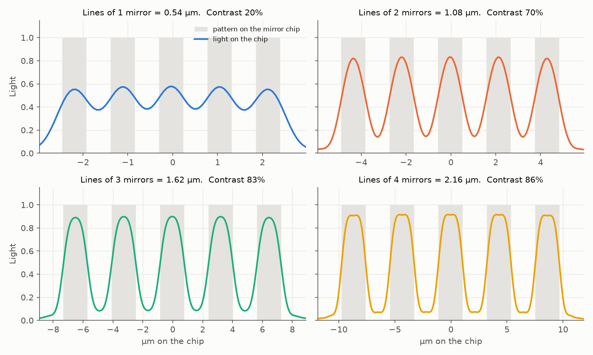
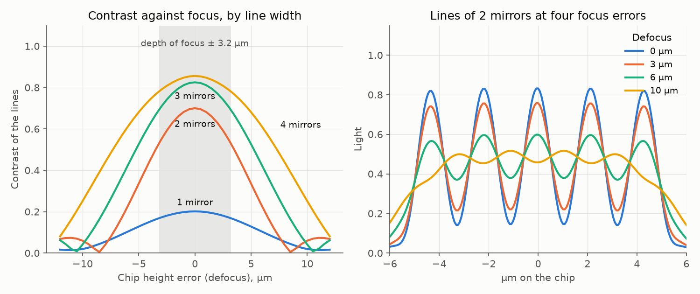
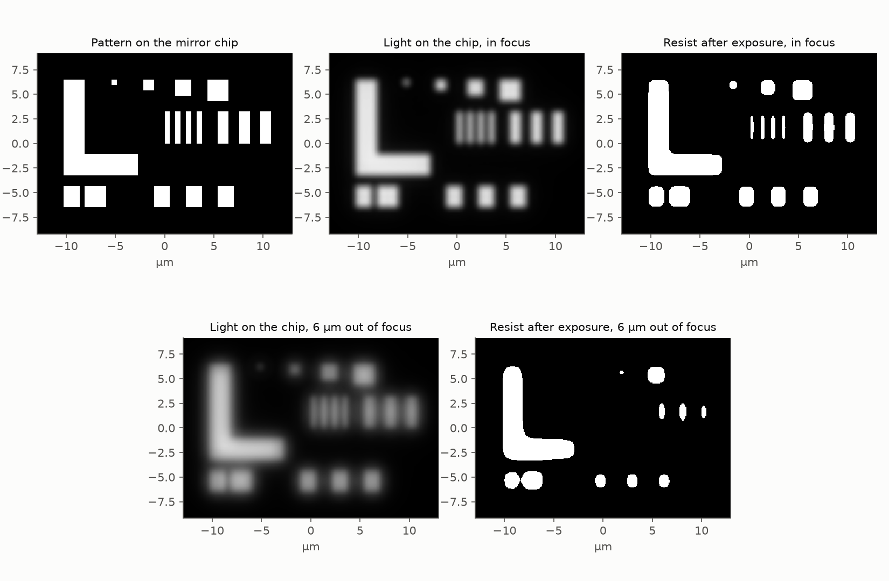
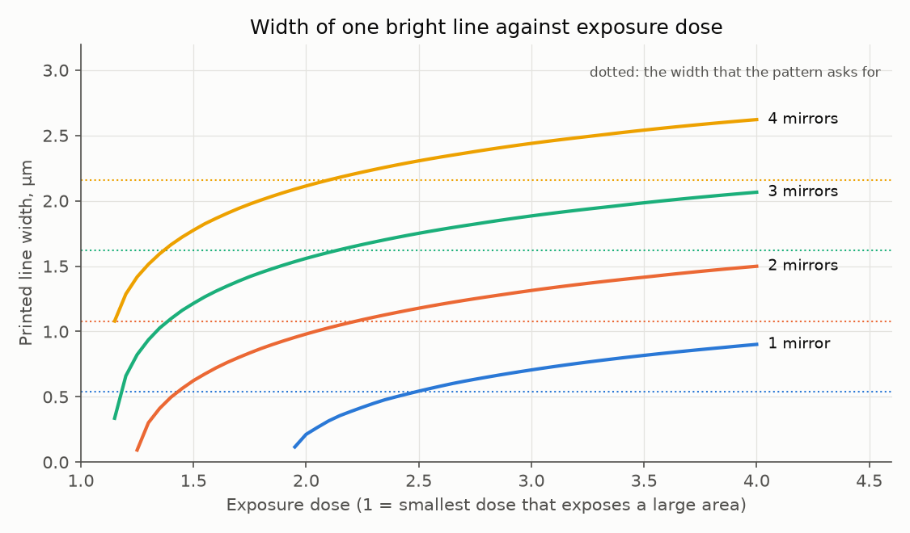

# Optics check

This page shows the light path as a ray diagram and gives the main optical numbers.
The distances come from the CAD (`cad/assembly.py`). The ray tracing is done by [Optiland](https://github.com/optiland/optiland), an open-source program.

Status of each value: [V] verified, [E] estimate, [U] unknown.

| Command | Result |
|---|---|
| `uv run --with optiland python -m optics.layout` | The numbers, and the ray diagram |
| `uv run --with optiland --with pyvista python -m optics.rays` | The light paths in 3D: picture, and `viewer/rays.json` for the 3D viewer |
| `uv run --with optiland python -m optics.simulate` | The five simulations |

## Ray diagram

- The real path is vertical. In the picture, left is up.
- Each colour is one point on the mirror chip: the centre and two opposite corners.
- Each point sends a narrow cone of light. The objective brings each cone to one point on the chip.
- Grey areas are the walls of the tubes and of the objective. The light must not touch them.
- The small grey box in the objective is a part of the lens that is not modelled. See "Limits".

## 3D view

There are two light paths. They use the same objective.

1. **Projector to chip (violet).** The light goes from the mirror chip straight down through the cube and the objective to the chip.
2. **Chip to camera (green).** The light goes from the chip up through the objective. The diagonal of the cube reflects it to the rear, to the camera sensor.

The camera sensor and the mirror chip are at the same optical distance from the cube. Thus, when the camera image is sharp, the projector image is sharp.

To turn the model with the mouse, open the 3D viewer ([assembly.md](assembly.md)) and click **Optics only**.
This view shows only the parts on the light paths. **Full machine** shows all parts.

- The picture shows the centre and the four corners of each image, with eight rays for each point.
- The long side of the mirror chip is drawn from front to rear [E]. Turn the camera in its clamp until its image agrees.
- The cube also reflects half of the projector light to the front wall of the holder. The picture does not show this lost light.

## Results

| Item | Value |
|---|---|
| Reduction from the mirror chip to the chip | 10 X |
| One mirror on the chip | 0.54 µm |
| Projector image on the chip | 1.04 × 0.58 mm |
| Camera view of the chip | 1.14 × 0.71 mm. The camera sees all of the projector image. |
| Smallest line that the objective can make | Approximately 1.0 µm, or 2 mirrors |
| Depth of focus at the chip | ± 3.2 µm |
| Focus movement at the chip for 1 mm of tube length | 10 µm |
| Smallest clearance between the light and a wall | 5.6 mm. With the baffle ring: 3.5 mm. |
| Blur from the glass of the cube | 0.04 µm. This is negligible. |
| Part of the projector light that enters the objective | Approximately 0.7 % [E] |

## What the results mean

1. **No CAD change is necessary.** No tube, wall or ring cuts the light.
2. **Focus is the critical adjustment.** The chip must be within ± 3 µm of the focus.
3. **The two arms must have the same length within ± 0.3 mm.** The two arms are cube to camera and cube to mirror chip.
   The CAD cannot give this accuracy, because the position of the mirror chip in the projector has an error of some millimetres [E].
   The SM1V10 corrects it. See "Set the focus" in [procedures.md](procedures.md).
4. **The focus for UV light is not the focus for visible light.** The cube causes 1.6 µm of difference.
   The objective causes more. Its value is [U]; tens of micrometres are possible [E].
   Thus, make a series of test exposures at different stage heights to find the UV focus.
5. **Exposures are slow.** The objective accepts a narrow cone of light, and the projector sends a wide cone.
   The remaining light hits the tube walls. The baffle ring and black walls decrease stray light.

## Simulations

Each simulation shows one effect. The objective is a perfect lens in all of them. A real objective is not better.

### 1. The image of one point (Airy pattern)

- Light is a wave. An objective cannot bring it to a perfect point.
- One point of light makes a small disc with weak rings around it. This is the Airy pattern.
- The radius of the disc is 0.61 × wavelength / NA = 0.98 µm. A larger NA or a shorter wavelength makes it smaller.
- The disc is larger than one mirror (0.54 µm). Thus the objective sets the smallest detail, not the mirrors.

### 2. Narrow lines lose contrast

- Each point of the pattern becomes one Airy disc. The discs of adjacent lines overlap.
- Contrast is the difference between the bright lines and the dark spaces. 100 % is perfect.
- Lines of 1 mirror have 20 % contrast: the spaces are almost as bright as the lines. A resist cannot print these lines reliably.
- Lines of 2 mirrors (1.1 µm) have 70 %. This is the practical minimum.

### 3. Focus

- When the chip is too high or too low, each disc becomes larger and the contrast goes down.
- Narrow lines are the most sensitive. At 6 µm of error, lines of 2 mirrors have less than half of their contrast.
- At 10 µm, the bright and the dark lines change places (right picture, yellow). This effect is called contrast reversal.
- The grey band is the depth of focus, ± 3.2 µm.

### 4. A full pattern, and the resist

- The resist is modelled as a switch: it is exposed where the light is more than half of full brightness.
- Corners become round.
- Small squares print too small, or not at all. The square of 1 mirror is absent.
- The lines of 1 mirror print in focus, but only just. A small error in focus or dose removes them.
- The gap of 1 mirror in the lower left bar stays open in focus. Out of focus, the shapes become smaller and the lines of 1 mirror are absent.

### 5. Exposure dose changes the line width

- The edge of a line is a slope of light, not a step. More dose moves the exposed edge outward.
- Each line width has its correct dose. A dose that is correct for wide lines is too small for narrow lines.
- A line of 1 mirror does not print at all below 2 times the smallest dose.
- Thus, find the dose with test exposures, and do not use lines of 1 mirror.

## Limits

- The objective is a purchased part, and its lens data is not published. The model uses a perfect lens with the published data: focal length 15.37, 10 X, NA 0.25, image 150 from the shoulder [V], Edmund Optics.
- A real objective is a thick lens. The model keeps the rays parallel to the axis for 9.5 mm in the objective. This is the standard method (principal planes).
- The model does not give the blur of the real objective or its focus difference between UV and visible light.
- Glass in the projector between the mirror chip and the lens face is not in the model [U].
- The light cone of the projector is f/1.7 [E]. The 0.7 % value comes from it.
- UV wavelength: 400 nm, from the LED part number [V].
- The simulations add light intensities (incoherent light). This is correct when the projector light cone is much wider than the cone that the objective accepts [E].
- The resist model is a simple switch. A real resist also depends on its thickness, its chemistry and the development time.
