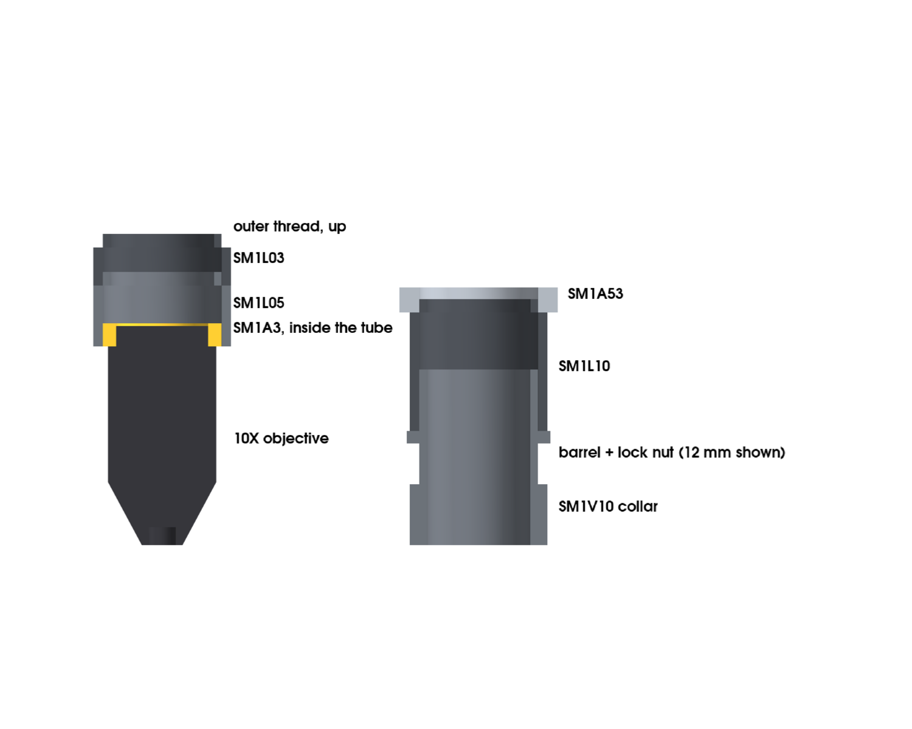
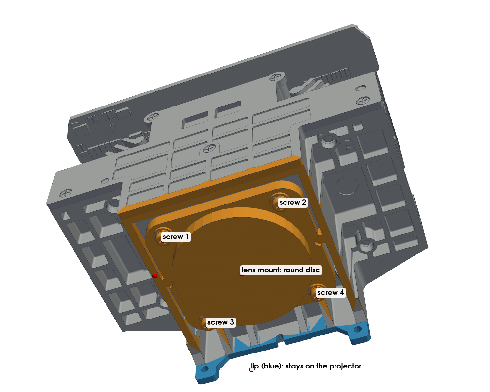

# Procedures

## 1. Print the parts

1. Open the STL files in the slicer. Do not turn the parts.
2. Set the quantity of each part. Refer to [parts.md](parts.md).
3. Set the material of each part.
4. Slice the parts.
5. Examine the preview:
   - Each part touches the bed with a flat face.
   - The slicer added no supports.
6. Print the parts.

## 2. Examine the fits

1. Close the two halves of the beamsplitter holder on a lens tube. A seam gap of less than 0.5 mm is satisfactory.
2. Put the cube into the base half. Hold the cube by its rough faces. Push lightly. The ribs hold the cube.
3. If a fit is incorrect, change the value in `cad/params.py` and build the part again.

| Fault | Value to change |
|---|---|
| Seam gap is larger than 0.5 mm | Increase `TUBE_BORE` by 0.2 |
| Tube is loose in a closed holder | Decrease `TUBE_BORE` by 0.1 |
| Cube does not enter | Decrease `CUBE_RIB` by 0.1 |
| Cube is loose | Increase `CUBE_RIB` by 0.1 |
| Sleeve does not enter the camera block | Increase `SLEEVE_BORE` by 0.2 |

The test piece (`00_test_piece.stl`) is optional. It has holes of 30.6, 30.7 and 30.8 mm with 1, 2 and 3 notches. Use it to measure a printer before a long print.

## Assemble the lens tubes (possible before the printed parts arrive)



Each lens tube contains a retaining ring. This is a thin threaded ring with two notches. Turn it with a fingertip or a pen.

Objective tube:

1. Turn the retaining ring of the SM1L05 clockwise until it is approximately 5 mm below the rim.
2. Screw the objective into the SM1A3 adapter by hand.
3. Screw the SM1A3 into the end of the SM1L05 that has no outer thread. Stop when it touches the retaining ring. The face of the SM1A3 is then level with the rim.
4. Remove the retaining ring from the SM1L03.
5. Screw the outer thread of the SM1L05 into the SM1L03.
6. Put the dust cap back on the objective.

Projector tube:

1. Turn the lock nut of the SM1V10 down to its collar.
2. Screw the barrel of the SM1V10 into the end of the SM1L10 that has no outer thread. Leave approximately 12 mm of barrel visible. If the retaining ring of the SM1L10 stops the barrel, turn the ring deeper.
3. Turn the lock nut up against the SM1L10. Do not tighten it yet. The focus procedure sets this length.
4. Screw the outer thread of the SM1L10 into the SM1A53 flange. The counterbores of the flange point away from the tube.

Keep these parts as spares: SM1V05, SM1CPL05, SM1A9.

## 3. Assemble the frame

The frame uses the four 500 mm bars:

```
   view from above                    view from the front

   A ====[U]==[U]=========            U   U     two uprights, on bar A
              |                       |   |
              B                    ===A=========
              |  (to the front)
```

- Bar A lies on the table, from left to right.
- The two uprights (U) stand on bar A, at its centre.
- Bar B lies on the table. It points to the front. It joins bar A to the right of the uprights.

1. Put the two halves of the beamsplitter holder together. Their total thickness is 44 mm.
2. Put the two uprights on bar A, with the holder between them as a gauge.
3. Attach each upright to bar A with two corner brackets. Make sure that the front faces of the uprights and of bar A align.
4. Attach bar B to the front face of bar A, 60 mm or more to the right of the right upright.
5. Put T-nuts into the slots: 3 in each front slot of the uprights, 4 in each back slot, 2 in the inner slot of the left upright, and 2 in the front slot of bar A.

CAUTION: The frame falls to the rear if it tilts more than approximately 13°. Do not push the top of the frame to the rear.

## 4. Install the parts

Install the parts from the top to the bottom. Tighten the frame screws only after all tubes align.

1. Prepare the projector. The Hacker Fab V2.1 build page shows a photo of each step (see [RESOURCES.md](../RESOURCES.md)).
   1. Disconnect all cables. Make a photo before each step.
   2. Remove the four poles and the top board.
   3. Remove the side board and the cover.
   4. Remove the screws and poles that hold the engine on the bottom plate. Remove the bottom plate.
   5. Remove the four screws at the lens face. Remove the lens with its mount.

   Keep the LED block, the heat sinks, the red board at the mirror chip and the two flat cables on the engine.

   

   The lens mount is the square flange with the round disc. The four screws are at its corners. The red line is the optical axis.

2. Put the adapter plate on the lens face. The cut edge of the plate is at the lip of the projector. The countersinks point down. Attach the plate with four M2 screws.
3. Look into the light hole. The mirror chip is in the centre.
4. Attach the SM1A53 flange below the plate with four M3 × 6 screws.
5. Put the plate on the projector bracket. The LED block of the projector points to the right. Attach the plate from below with four M3 screws.
6. Bolt the base half of the beamsplitter holder to the inner face of the left upright.
7. Put the cube, the tubes and the sleeve into the base half. Install the cover.
8. Bolt the camera clamp block to the back faces of the uprights.
9. Install the tube clamp on the objective tube. Install the board rails. Put the rails at a height where the projector cables reach the main board.
10. Bolt the stage base to the front face of bar A, on the left. Put the micro-manipulator stand in the rim.
11. Attach the chip holder to the end effector.

Recommended lens tubes:

| Arm | Parts, from the holder outward | Length |
|---|---|---|
| Objective (down) | SM1L03, SM1L05, SM1A3, objective | 21.9 mm to the objective shoulder |
| Projector (up) | SM1V10 (collar in the holder, barrel up), SM1L10, SM1A53 | adjustable: 45 to 66 mm; 54 in the model |
| Camera (back) | printed sleeve | 78 mm |

CAUTION: The distance between the objective and the chip is 1.5 mm. Lift the stage slowly.

## 5. Set the focus

1. Move the stage in Z until the camera shows a sharp image of the chip.
2. If the stage has no travel left, slide the camera in its saddle.
3. Project a pattern. Turn the SM1V10 until the pattern is sharp on the camera.

If the SM1V10 has no travel left, change the tubes. No new part is necessary.

| Fault | Change |
|---|---|
| Barrel is fully out and the pattern is not sharp (tube too short) | Put the SM1V05 between the SM1L10 and the SM1A53. This adds approximately 21 mm. |
| Barrel is fully in and the pattern is not sharp (tube too long) | Objective tube: SM1L10 only. Projector tube: SM1V05, SM1L05, SM1A53. |
